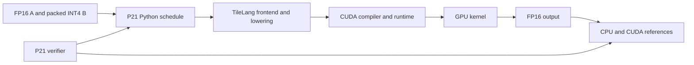
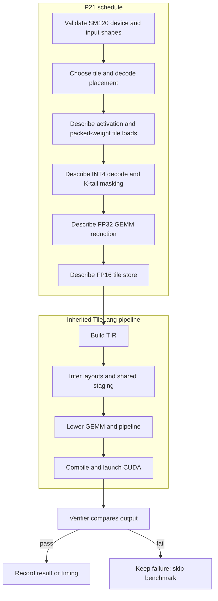

# Low-precision tensor compiler

## Contents

- [Architecture and execution guide](#architecture-and-execution-guide)
- [Reproduce on Windows CUDA](#reproduce-on-windows-cuda)
- [Verification evidence](#verification-evidence)
- [Research context and attribution](#research-context-and-attribution)

## Architecture and execution guide

This checkout contains upstream TileLang and a focused Python schedule example. P21 adds a signed INT4 GEMM schedule and its verifier. TileLang still owns TIR construction, lowering, layout inference, CUDA code generation, and launch. The exact accumulation option is separate; the default remains the FP32 tensor-core path.

The diagram shows where the example ends and the inherited compiler begins.



For each output tile, P21 loads [packed INT4](#packed-int4) weights, decodes signed nibbles, and multiplies them by FP16 activations. A compile-time [decode placement](#decode-placement) choice places decoded weights in registers or a swizzled shared-memory tile. The reduction accumulates in FP32, masks an [odd K tail](#odd-k-tail), and stores FP16. Drive checks correctness before profiling or timing. The separate [exact accumulation](#exact-accumulation) option uses integer accumulation and direct FP16 rounding, with a different cost profile.



| Subsystem | Responsibility and owned invariant | Source |
| --- | --- | --- |
| P21 schedule | Validate device and tensor contract; create tiled GEMM and output | [`p21_fp16xint4.py`](examples/dequantize_gemm/p21_fp16xint4.py) |
| Quickstart | Construct sample input and call the example | [`p21_quickstart.py`](examples/dequantize_gemm/p21_quickstart.py) |
| Verification driver | Check environment, execute GPU checks, retain evidence, and gate measurement | [`p21_verify.py`](tools/p21_verify.py) |
| Exact diagnostic | Check finite FP16-by-INT4 inputs against a rounded independent oracle | [`p21_exact.py`](tools/p21_exact.py) |
| TileLang compiler | Own compiler and runtime behavior inherited upstream | [`tilelang/`](tilelang/) |

### Run one GEMM

1. Create FP16 activation matrix A and packed signed INT4 weight matrix B. Even K occupies the low nibble.
2. Call the schedule. It checks the supported active device and chooses a tile and decode placement.
3. TileLang lowers the schedule and compiles the generated kernel through the installed CUDA toolchain.
4. The GPU decodes weights, masks an odd K tail, reduces, and writes FP16 output.
5. Drive compares output with independent references. A failed correctness check stops measurement and retains failure evidence.

<a id="packed-int4"></a>
<details><summary>What is packed INT4?</summary>

Packed INT4 stores two signed four-bit integers in one byte. P21 places even K in the low nibble and odd K in the high nibble. For example, `-1` and `3` share a byte after two's-complement encoding.
</details>

<a id="decode-placement"></a>
<details><summary>What is decode placement?</summary>

Decode placement selects where the kernel expands packed nibbles. P21 chooses register fragments or a swizzled shared-memory tile at compile time; this bounded heuristic is not a general search system.
</details>

<a id="odd-k-tail"></a>
<details><summary>What is an odd K tail?</summary>

An odd K dimension leaves one unused nibble in the final byte. P21 masks that lane so padding cannot affect the dot product; verification poisons the unused nibble to check the case.
</details>

<a id="tensor-core-accumulation"></a>
<details><summary>What is tensor-core accumulation?</summary>

The default path accumulates in FP32 before converting to FP16. Cancellation can still exceed the original two-ULP gate for larger cases, as the evidence below records.
</details>

<a id="exact-accumulation"></a>
<details><summary>What is exact accumulation?</summary>

The optional mode sums finite FP16-by-INT4 products as scaled signed integers, then rounds once to FP16. It has a separate measured cost and uses scalar rather than tensor-core accumulation.
</details>

<a id="two-ulp-gate"></a>
<details><summary>What is the two-ULP gate?</summary>

The gate limits output error to two representable FP16 steps from the rounded CPU float64 reference. Passing an absolute-relative tolerance does not pass the gate when ULP error is larger.
</details>

<a id="sm120"></a>
<details><summary>What is SM120?</summary>

SM120 is the CUDA compute capability targeted by the P21 entry point. The example rejects a different active device and does not dispatch across GPUs.
</details>

### Design choices and limits

These rationales are inferred from the implementation; behavior and measured limits are documented in the evidence sections below.

| Choice | Current behavior and rationale | Alternative and cost to reconsider |
| --- | --- | --- |
| Python schedule over compiler changes | Keeps the extension focused while reusing TileLang lowering. | A native compiler pass could generalize behavior but expands compiler maintenance. |
| Decode packed input in kernel | Avoids requiring a pre-expanded weight tensor at the call boundary. | Predecode simplifies compute but consumes expanded storage and shifts decode work to callers. |
| Compile-time register/shared choice | Avoids runtime branching between placement policies. | Runtime choice needs dispatch and evidence across shapes and devices. |
| FP32 tensor-core default | Uses existing GEMM lowering and preserves current default behavior. | Exact integer mode improves finite rounding but costs tensor-core throughput. |
| SM120 device restriction | Matches the verified target without implying portability. | Multi-architecture dispatch needs separate builds and verification evidence. |

This repository preserves the upstream TileLang compiler source, examples, history, and MIT license at `v0.1.15` (`a35f8ddf45eba16c21211ec8822d56ce5363036f`). The original upstream landing page is preserved verbatim as [README.upstream.md](README.upstream.md). The P21 addition is a focused Python TileLang schedule example and its real-GPU verification driver; it does not modify TileLang's native compiler or runtime.

## Implemented path

[`examples/dequantize_gemm/p21_fp16xint4.py`](examples/dequantize_gemm/p21_fp16xint4.py) packs two signed INT4 values per byte, even K index in the low nibble, and compiles `A[M,K] @ B[N,K].T` for FP16 activations and signed values in `[-8, 7]`. The kernel decodes each packed tile, masks odd K tails, accumulates in FP32, and stores FP16. Its compile-time policy chooses either a register fragment or a swizzled shared-memory tile for decoded weights, alongside M/N/K tiles and pipeline stages.

P21 reuses TileLang's TIR frontend, pipeline, memory allocation/copy, layout inference, GEMM lowering, and native CUDA compiler. The authored extension is the schedule and decode-placement policy in the Python example; it is a bounded placement heuristic, not a reproduction of Ladder's search or compiler transformations. The current public API explicitly supports the active SM120 CUDA device and does not claim multi-GPU dispatch.

```powershell
$python = (Resolve-Path .venv\Scripts\python.exe).Path
& $python examples\dequantize_gemm\p21_quickstart.py
```

Run the example by script path from the repository root. It imports the installed TileLang wheel and the P21 module beside the script; importing `tilelang` from a Python `-c` command at the checkout root instead resolves the unbuilt development tree.

For the exact input contract, resource heuristic, validation, and benchmark limitations, see the [P21 guide](examples/dequantize_gemm/P21.md).

## Reproduce on Windows CUDA

The tested environment used Python 3.11, the official TileLang 0.1.15 Windows wheel, PyTorch 2.11.0 with CUDA 12.8, CUDA Toolkit 13.0.88, and an RTX 5080 Laptop GPU (SM120). Use a clean project-local virtual environment and install CUDA Toolkit separately from NVIDIA. PowerShell commands below use paths relative to the checkout; set `CUDA_PATH` to the installed Toolkit directory.

```powershell
py -3.11 -m venv .venv
$python = (Resolve-Path .venv\Scripts\python.exe).Path
$env:CUDA_PATH = Read-Host 'Path to CUDA Toolkit 13.0.88'
& $python -m pip install --index-url https://download.pytorch.org/whl/cu128 'torch==2.11.0+cu128'
& $python -m pip install --require-hashes --no-deps -r requirements-p21-win-cu128.lock
& $python -m pip install --index-url https://pypi.org/simple 'ruff==0.16.5'

$env:CUDA_HOME = $env:CUDA_PATH
$env:PATH = "$env:CUDA_PATH\bin;$env:PATH"
nvcc --version
& $python tools\p21_verify.py --doctor
& $python tools\p21_verify.py --drive
& $python tools\p21_verify.py --profile
& $python tools\p21_verify.py --benchmark
& $python -m ruff check examples\dequantize_gemm\p21_fp16xint4.py examples\dequantize_gemm\p21_quickstart.py tools\p21_verify.py
& $python -m ruff format --check examples\dequantize_gemm\p21_fp16xint4.py examples\dequantize_gemm\p21_quickstart.py tools\p21_verify.py
```

The requirements lock pins the official release wheel and runtime dependency versions with SHA-256 hashes. PyTorch is installed first from its official CUDA 12.8 wheel index; the lock is then installed with dependency resolution disabled so it cannot replace that Torch build. Doctor and Drive run the real TileLang compiler and CUDA kernel. Profile is diagnostic; Benchmark excludes warm compilation and reports both public-call wall time and CUDA-event stream time.

## Verification evidence

An opt-in `accumulation="exact"` path now addresses cancellation without loosening the numerical gate. It sums finite FP16-by-INT4 products as scaled signed integers and rounds directly to FP16 once. [The exact-mode report](docs/evidence/P21/exact-20261024/results.md) retains **3,174,707 checked outputs**, including all finite FP16 encodings with all 16 signed INT4 values and all nine earlier shapes. Finite results matched the independent rounded FP64 oracle with zero ULP error. The original FP32 tensor-core path remains the default and retains its documented cancellation limits. Exact mode supports K up to 1,049,088, uses scalar rather than tensor-core accumulation, and has separately measured cost.

This stronger correctness run used at most 8,405,504 bytes of Torch device allocation and a 1,002,360,832-byte parent-process peak working set. Its recorded drive took 22.82 seconds after Doctor, including kernel compilation, the oracles, a small timing experiment and a separate diagnostic profile. Those memory measures exclude compiler children and non-Torch device allocations. Reproduce with `python tools/p21_exact.py --output <new-evidence-directory> --benchmark` in the documented CUDA environment. The small timing ranges overlap; no speedup follows.

The coordinated campaign on 22 October 2026 measured six frozen shapes and three held-out shapes at seed 21. Each side received 100 warmup calls and 20 more before each sample, then seven rotated samples of 200 calls. All outputs passed independent CPU float64 and CUDA float32 references at ATOL0.0625/RTOL0.001. However the expanded benchmark disabled the original two-FP16-ULP hard gate; it did not retain all original acceptance checks. There is no independent timestamped evidence that this broader numerical boundary was approved before observations. The original default128×256×256 benchmark/profile now enforce two ULP again, and Drive stays strict. No GPU rerun or numerical kernel fix accompanied that restoration.

The original-gate audit below reports every side's maximum ULP against CPU float64 rounded to FP16. Only three frozen cases also satisfy the original two-ULP criterion. Timings for the other six cases are diagnostic under the weaker absolute-plus-relative criterion and cannot support an equal-quality speed claim under the original gate. Raw receipts are preserved unchanged.

| M,N,K | Auto | Fragment | Shared | Packed Torch | Predecoded Torch | Original 2-ULP gate |
| --- | --- | --- | --- | --- | --- | --- |
| 1,4096,4096 | 1 | 1 | 1 | 0 | 0 | PASS |
| 16,1024,1024 | 1 | 1 | 1 | 1 | 1 | PASS |
| 128,1024,1024 | 14 | 14 | 14 | 14 | 14 | FAIL |
| 512,1024,1024 | 29 | 29 | 29 | 29 | 29 | FAIL |
| 256,2048,2048 | 204 | 204 | 204 | 188 | 188 | FAIL |
| 33,257,513 | 1 | 1 | 1 | 1 | 1 | PASS |
| 256,1536,1536 | 23 | 23 | 23 | 23 | 23 | FAIL |
| 384,768,1024 | 32 | 32 | 32 | 32 | 32 | FAIL |
| 192,1024,2048 | 38 | 38 | 38 | 38 | 38 | FAIL |

The automatic placement heuristic remains unchanged. A tested long-K fragment override did not establish a public-call improvement across held-out shapes and was reverted. Larger-case numerical diagnosis remains open; the existing mixed tolerance does not make a204-ULP result satisfy the original gate.

The following timing table includes only the three cases whose recorded errors satisfy the original gate. It reports host wall milliseconds as median [minimum,maximum]. The packed Torch baseline includes eager signed decoding and optimized dense matmul. Predecoded cuBLAS retains expanded FP16 weights and excludes their decode, so it is a compute-only control with a different storage cost. Both dense controls request FP32 output before final FP16 rounding; default FP16 output failed the frozen large-case ATOL/RTOL checks.

| M,N,K | Auto | Packed decode + matmul | Predecoded cuBLAS |
| --- | --- | --- | --- |
| 1,4096,4096 | .15950 [.05967,.38268] | 1.59914 [1.17676,1.76736] | .20879 [.05477,.59314] |
| 16,1024,1024 | .02896 [.02684,.03182] | .16342 [.15191,.17614] | .02249 [.02048,.02465] |
| 33,257,513 | .03066 [.02745,.03384] | .16618 [.15485,.18206] | .02311 [.01984,.02551] |

These three cases support lower latency than the scoped eager packed-input baseline. They do not establish superiority over a tuned fused INT4 library; the predecoded control is faster at16×1024×1024. Raw wall and CUDA-event samples, batch p95, every shape/side's original-gate PASS/FAIL, numerical errors, compilation-or-cache-lookup time, memory and held-out diagnostics are in [the curated metrics](docs/evidence/P21/metrics-summary.json), with SHA256 hashes of immutable raw receipts. Maximum observed Torch peak allocation was167,968,768 bytes and peak reservation333,447,168 bytes. Larger diagnostic outputs have maximum absolute error0.5 and up to204ULP; passing ATOL/RTOL does not override their failed two-ULP criterion.

CUDA events measure elapsed stream spans and can include gaps while Python enqueues work. They do not establish continuous GPU busy time. The separately retained CUDA-graph diagnostic removes the public-operation dispatch and allocation path, with a maximum reservation of 254MiB, but replay enqueue gaps can remain. It is not public-call latency. A separate Torch profiler trace identified the extra decoded shared staging in the candidate comparison; timings from that trace are diagnostic. Earlier runs with unconfirmed resource isolation remain diagnostic and are excluded from this table.

Reproduce after Doctor and Drive in an exclusive GPU slot:

```powershell
& $python tools/p21_verify.py --sweep --evidence-dir .verification-runs/P21-metrics-clean-sweep
& $python tools/p21_verify.py --held-out --evidence-dir .verification-runs/P21-metrics-clean-held-out
& $python tools/p21_verify.py --graph-diagnostic --evidence-dir .verification-runs/P21-metrics-clean-graph-diagnostic
& $python tools/p21_summarize.py
```

The maintained numerical diagnostic is `tools/p21_diagnose.py`. A subsequent [large-GEMM diagnosis](docs/evidence/P21/numerical-diagnosis.md) passed Doctor and strict Drive, then reproduced the large-case failure. TileLang had 33 of 524,288 finite outputs above two FP16 ULP (maximum 204); an ordinary FP32 dense control also failed, while the CUDA FP64 control stayed within one ULP. The worst dot product had severe cancellation. The original gate remains unchanged, and no larger-case equal-quality speedup is claimed.

A fresh [strict Drive recheck](docs/evidence/P21/drive-recheck-20261022.json) after host memory became available passed all four default cases, special-value/poisoned-tail checks and three invalid-input checks on the same SM120 environment. It does not supersede the expanded-shape failures or supply new timing results. The separate exact mode added on 24 October has its own implementation, correctness checks and measured cost above; the FP64 diagnostic is not substituted for the tensor-core path.

The compact [GPU evidence bundle](docs/evidence/P21/README.md) includes the actual SM120 Drive and Benchmark JSON plus generated CUDA and TIR from the measured run. The measured medium 128×256×256 output had maximum absolute error `0.0625`, maximum 2 FP16 ULP, and one of 32,768 outputs above 1 ULP versus CPU float64 rounded to FP16. A deterministic odd-K test poisoned the unused high nibble to `0xF` and produced exact cancellation, signed, and zero outputs.

The earlier small-shape timing JSON remains historical evidence under its original two-ULP check. Its broad ranges did not establish a decode-placement advantage. The coordinated expanded campaign has the explicitly limited scope audited above.

The inherited upstream fallback GEMV passed its reference checks with maximum absolute error 0.125 and maximum 4 FP16 ULP on its recorded input. The upstream fast-LOP3 example still fails NVCC on the tested CUDA 13 toolchain; details and the compiler diagnostic boundary are in the [P21 guide](examples/dequantize_gemm/P21.md).

The active GitHub Actions workflow runs only CPU syntax, lint, and evidence-integrity checks. It does not install TileLang or claim to execute CUDA. Original upstream CI, distribution, bot, and documentation workflow files remain byte-for-byte under [`maint/upstream-workflows/`](maint/upstream-workflows/), outside GitHub's active workflow directory.

## Research context and attribution

P21 is informed by the [CMU FP16xINT4 final report](https://www.andrew.cmu.edu/user/zhiboc/15745-fa24/final_report.pdf) and [Ladder, OSDI 2024](https://www.usenix.org/system/files/osdi24-wang-lei.pdf). The report's kernel implementation was independently written; no student source or published benchmark results are copied or claimed. The underlying compiler is TileLang under the upstream MIT license; see the preserved [LICENSE](LICENSE) and [upstream README](README.upstream.md).
